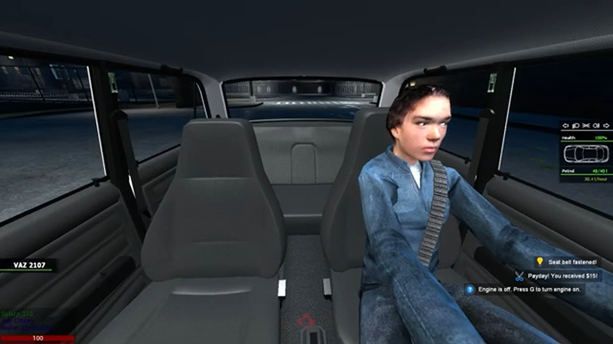
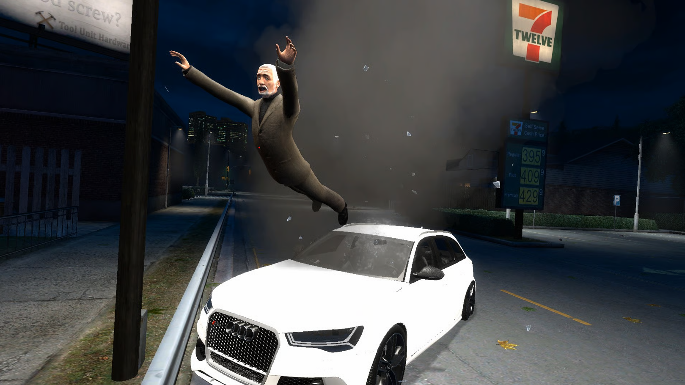
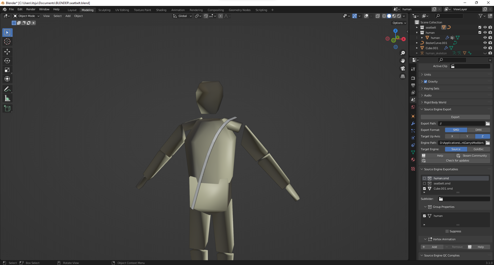
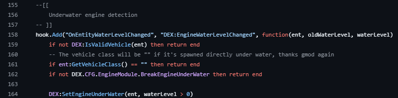
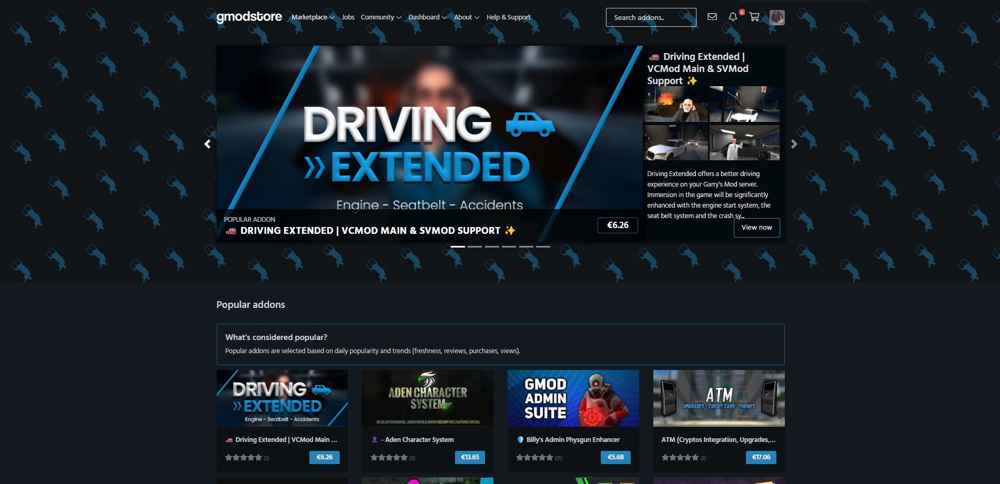
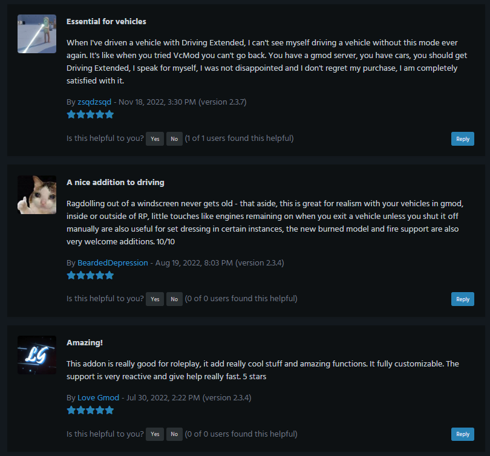
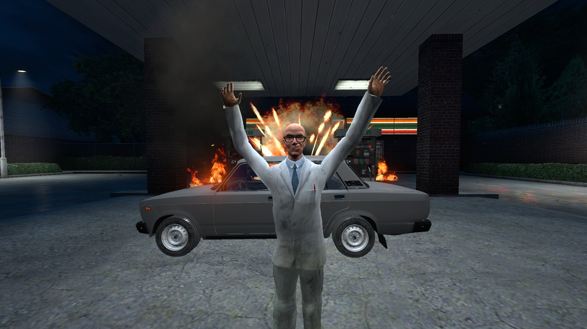

_As of May 28, 2023, the add-on has officially been discontinued due to time constraints._
_If you wish to get the addon for free instead of getting it from untrusted sources, feel free to reach me out on [Discord](https://itsjustmiaouss.com/discord)._

Driving Extended is an add-on made for Garry's Mod and is available on [gmodstore](https://www.gmodstore.com/market/view/driving-extended-enjoy-driving-again-vcmod-main-els-support). It offers a better driving experience for the players and comes with 5 different modules.

# Driving Extended, what's that?



## ⚙️ Engine module

Vehicles in Garry's Mod are quite easy to use - you enter them and start moving. This first module is focused on the engine.

Now, the engine is initially off. You have to press a key to turn it on. The headlights can only be turned on when the engine is started and are automatically turned off when you turn off the engine. If the engine is left running, the vehicle will continue to consume fuel and is going to play an idle sound.

## ⚙️ Seat belt module

When you're involved in a car accident, the seat belt protects you from being hurt. That's the whole point of this module.

The seat belt reduces the damage received during an accident. And of course, you cannot leave your vehicle when your seatbelt is fastened.

When the seatbelt is fastened, it'll be visible to all players as a 3D model over the player model.

## ⚙️ Accident module

Depending on the speed of your vehicle, an accident can cause more or less damage to the players. As we have seen, the seatbelt prevents players from taking too much damage but doesn't prevent players from being stunned or ejected through the windshield!

After an accident, the vehicle's hazard lights are automatically turned on and the engine is stopped.

And there's so much more I can't cover here!

# What did I learn?

Coding for Garry's Mod with a professional perspective was quite challenging. Your code is reviewed by the moderators and they give you hints on how to make your code perform better.
It's a great way to learn because you have to find the solution and adapt your coding style for the feature you want to implement.

Optimization is also a big topic. Garry's Mod itself is quite old and players often to download thousands of addons, so each line of your code must be executed as quickly as possible.
They have [a really good article](https://www.gmodstore.com/help/script-submissions/topics/developer-guidance) dedicated to this topic.

It was also the first time I launched Blender to design the 3D seatbelt model!

Quite simply, I drastically improved the way I code (code styling, organizing my project better), learned how to support users (fixing bugs and listening to suggestions), how to create my own illustrations and how to deal with Garry's Mod bugs and find workarrounds (really)...

# What were my motivations?

The first version of Driving Extended was published on GitHub. I spent nights finalizing this project because I loved it so much. I wanted people to see it and use it and the best way was to publish it to gmodstore. And it worked!

From March 9, 2022 to May 28, 2023, the addon got a total of 12.8K views and 255 purchases. There were 33 tickets solved over this same period of time.

# Footnote

Overall, it was an amazing experience! And I want to thank all the people who supported me and my project!
