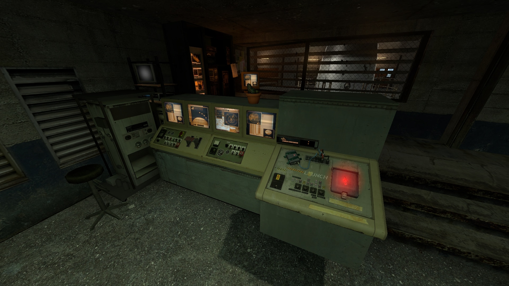
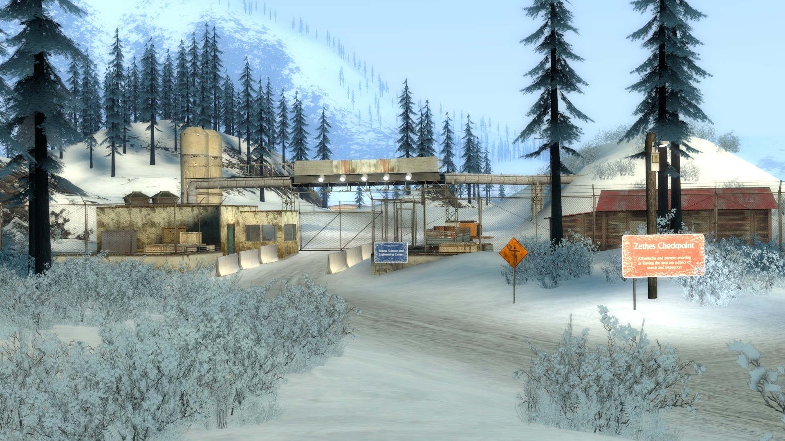
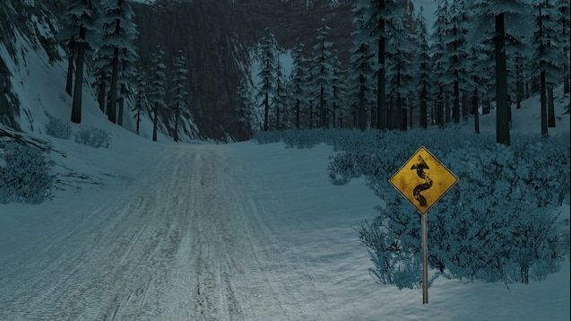

First released on December 17, 2022 on the Steam Workshop, **gm_ijm_boreas** is an overhaul of *gm_boreas*, the iconic scenic winter map originally created by [Blueberry_pie](https://steamcommunity.com/id/Blueberry_pie).

The original map is an absolute masterpiece, but there were a few specific gameplay elements, interactions, and details I always wanted to tweak for my ow server and roleplay sessions. Instead of keeping those edits to myself, I polished them up and shared them with the Garry's Mod community!

## gm_ijm_boreas, what’s that?

### 🚀 Launchable missile
In the original map, the missile silo was mostly decorative. Every players playing the original map already tried to launch it. So, I completely reworked the missile system so it can actually be launched! It now features full launch sequences, sound effects, smoke plumes, and a dedicated console command (`ent_fire rocket_respawn trigger`) to reset the rocket on servers without having to reload the entire map.



### 🚧 Relocated security checkpoint & electric fences
To improve roleplay flow and map progression, I moved the security checkpoint further up the mountain road. I also added functional electric fences surrounding the research facility (which server owners can disable via console with `ent_remove_all checkpoint_electric_fence`) and made sure the security blast doors start closed by default.



### ⛅ StormFox 2 compatibility (daylight cycle)
One major headache with custom Source Engine maps is external weather and day/night cycles. In gm_boreas, the 3D skybox uses a solid radial gradient overlay (`skybox_fog.vmt` with `$nofog`) that clashed badly with night lighting. With some advice from Blueberry_pie, I adjusted the skybox materials and fog parameters to ensure seamless transitions when running with StormFox 2.

This tiny lua script is embedded into the map files and run automatically.

```lua
-- This is a simple script used to control the 3D Skybox Color.

local canInitialize = false
local factor = 255 + 85 -- 255 + x to make a darker color
local mat1, mat2

hook.Add("Initialize", "IJMBoreas:MapInitialize", function()
	canInitialize = game.GetMap() == "gm_ijm_boreas"

	if canInitialize then
		mat1, mat2 = Material("boreas/effects/skybox_fog"), Material("boreas/effects/skybox_mountainrange")
	end
end)

hook.Add("Think", "IJMBoreas:SetSkyboxFog", function()
	if not canInitialize or StormFox2 == nil then
		hook.Remove("Think", "IJMBoreas:SetSkyboxFog")
		return
	end

	local fogColor = StormFox2.Fog.GetColor()
	local newColor = Vector(fogColor.r / factor, fogColor.g / factor, fogColor.b / factor)
	-- fogColor.a = math.Clamp(fogColor.a, 0, 0.6)

	mat1:SetVector("$color", newColor)
	-- mat1:SetFloat("$alpha", fogColor.a)

	mat2:SetVector("$color", newColor)
	-- mat2:SetFloat("$alpha", fogColor.a)
end)
```

### 🏔️ Terrain & displacement tweaks
Along with moving props and checkpoints, I resculpted several displacements, smoothed out steep hills, and scattered realistic US road signage across the map using custom models.



## The Mapping Pipeline & Custom Tooling

Working with large Source Engine maps in 2024+ is an adventure of its own (send help 😒).

### Hammer++
Compiling a massive map like Boreas with vanilla Hammer (and after [fixing some issues in the gmod's code](https://github.com/Facepunch/garrysmod-issues/issues/5862)) is asking for crashes. I switched entirely to [Hammer++](https://ficool2.github.io/HammerPlusPlus-Website/) on the x64 beta branch of Garry's Mod and used custom compilers to bypass the brushes and leafs limitations. Surprisingly, a full LDR + HDR compile only takes around **20 minutes** on a Ryzen 5 3600X!

### Building BSPIntegrator out of frustration
To pack custom models, sounds, and textures into the final `.bsp`, people traditionally rely on [Vide](https://developer.valvesoftware.com/wiki/VIDE). However, Vide kept crashing, corrupting files, and failing to detect dependencies on a map of this scale. 

Out of frustration, I wrote my own standalone open-source tool: [BSPIntegrator](https://github.com/ItsJustMiaouss/BSPIntegrator). It automated the packing of the `embed` folder cleanly, without missing assets or corrupting the BSP header.

## What did I learn?

Taking on someone else's complex Source Engine project forced me to level up my mapping and modeling skills fast:
* **Blender & Crowbar:** I had to decompile `.mdl` files, edit collisions and meshes in Blender using Blender Source Tools, and recompile them back to `.mdl` cleanly.
* **Community feedback balancing:** Moving a road checkpoint sounds simple until players point out texture bugs and missing props! Reading through hundreds of comments taught me a ton about how varied server setups and roleplay communities really are.
* **Open source mapping:** Sharing the decompiled Hammer [sources .vmf](https://steamcommunity.com/workshop/filedetails/discussion/2903049970/4355621251096202404/) (with the permission of the original creator) allowed other server owners and mappers to learn from the project or make their own server-specific tweaks.

## 🎊 A few numbers

The map quickly grew far beyond what I initially expected:

* **Over 30,000 subscribers** on the Steam Workshop
* **70,000+ unique visits**
* **4,500+ favorites** with a 5-star rating across 1,000+ reviews
* Included in over **34,000 player collections**

Seeing so many servers and community featuring my work made all the compile hours completely worth it.

## Footnote

A huge thank you to **Blueberry_pie** for creating such an incredible foundation and for being so helpful, as well as everyone in the community who provided bug reports, suggestions, and feedback!

If you enjoy the map and want to support my open-source tools and projects, you can drop a small tip on [Ko-fi](https://ko-fi.com/itsjustmiaouss) — it really means the world! ❤️

- [Steam Workshop](https://steamcommunity.com/sharedfiles/filedetails/?id=2903049970)
- [BSPIntegrator on GitHub](https://github.com/ItsJustMiaouss/BSPIntegrator)
