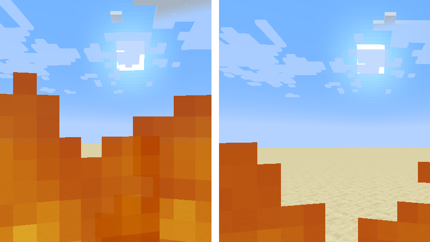
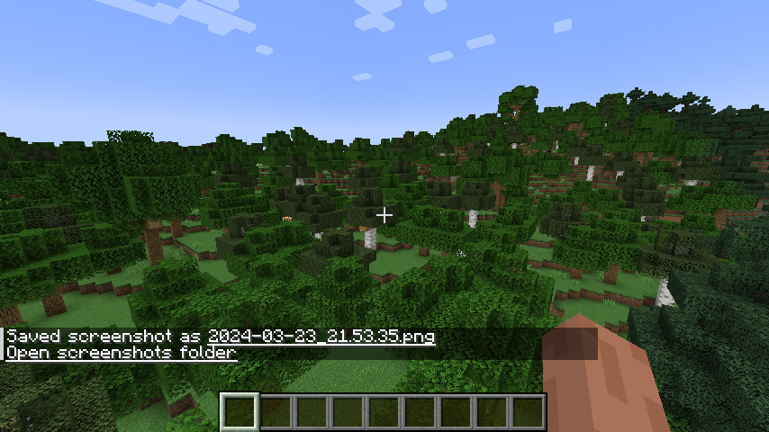
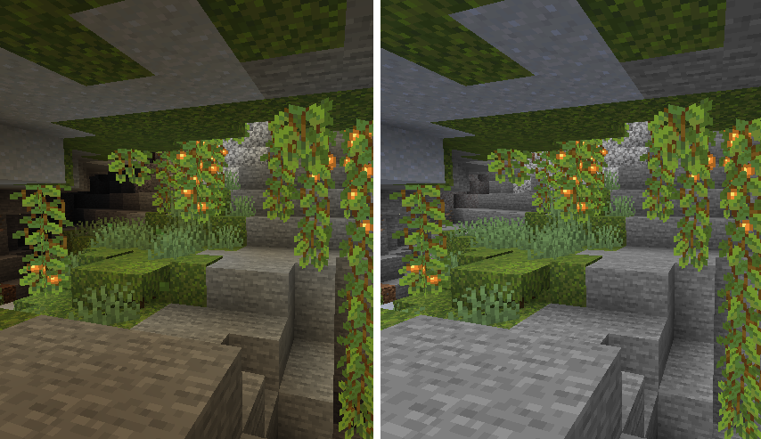
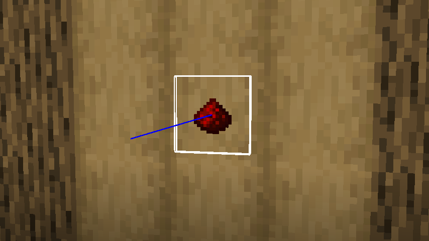

First realed on September 2, 2023 for Minecraft 1.20, **IJM's Tweaks** is a lightweight, client-side Fabric mod designed around a simple philosophy: giving players granular control over small quality-of-life improvements.

Every single setting is completely toggleable so it adapts to the way you want to play the game without forcing anything on you.

## IJM's Tweaks, what's that?

### 🪜 Smart auto-jump on stairs
Auto-jump in vanilla Minecraft can be notoriously annoying, but going up stairs smoothly and faster than usual is one of the few places where it actually feels good. 

This tweak dynamically toggles auto-jump on only when you step on stairs (and checks if there's actually another stair block above it), then immediately disables it once you step off:

```java
@Mixin(Block.class)
@Environment(EnvType.CLIENT)
public abstract class StairsBlockMixin {

    @Inject(method = "stepOn", at = @At("HEAD"))
    private void toggleAutoJump(Level level, BlockPos pos, BlockState state, Entity entity, CallbackInfo ci) {
        if (!level.isClientSide()) return;

        Minecraft minecraft = Minecraft.getInstance();
        LocalPlayer player = minecraft.player;
        if (player == null || entity != player) return;

        IJMTweaksConfig config = IJMTweaksConfig.get();
        if (!config.autoJumpOnStairs) return;

        OptionInstance<Boolean> autoJump = minecraft.options.autoJump();
        boolean shouldEnable = false;

        if (state.getBlock() instanceof StairBlock) {
            if (state.getValue(BlockStateProperties.WATERLOGGED)) return;

            // Is the block upside down
            if (state.getValue(BlockStateProperties.HALF) == Half.TOP) return;

            Direction facing = state.getValue(HorizontalDirectionalBlock.FACING);
            BlockPos upperPos = pos.relative(facing).above();
            BlockState upperState = level.getBlockState(upperPos);

            if (!(upperState.getBlock() instanceof StairBlock)) return;

            shouldEnable = true;
        }
        autoJump.set(shouldEnable);
    }
}
```
[Source code](https://github.com/ItsJustMiaouss/ijm-tweaks/blob/cdfac7220b7e182ef543a38e1c516664d097928f/src/main/java/com/itsjustmiaouss/ijmtweaks/mixin/StairsBlockMixin.java) available on GitHub. [MIT License](https://github.com/ItsJustMiaouss/ijm-tweaks/blob/26.3/LICENSE).

### 🔥 Lower fire overlay
When you catch fire in vanilla Minecraft, half of your screen gets covered in flames, making it almost impossible to see where you're running. This tweak lowers the height of the first-person fire rendering so you can actually navigate while burning.. Actually better than nothing. You can also totaly disable it, at your own risks!



### 📸 Quick screenshot folder access
Taking a screenshot usually prints a chat message with a direct link to the image file, but finding the rest of your screenshots can be a hassle. This tweak appends a button straight into chat allowing you to open the screenshots folder with one click.



### 💡 Fullbright toggle
Need to check dark caves without messing around with gamma sliders or night vision potions? A simple customizable keybinding lets you toggle fullbright on and off on the fly. There's no need to add a third-party mod or resource pack.



### 📦 Invisible entities hitbox
When debugging or working as an admin, pressing `F3 + B` shows entity hitboxes, but invisible entities can still be tricky to see. This option renders hitboxes for invisible entities. To avoid abuse, it checks that you have the operator permission on the dedicated server you're playing, and if you're not in a survival-like mode.



And there are plenty of other subtle tweaks packed inside! Feel free the read the hole description on GitHub or Modrinth (links below).

## What did I learn?

Getting into the Fabric toolchain and playing around with Mixins was honestly wild. You're injecting code directly into client ticks and render loops, so one wrong move and you completely break compatibility with mods like Sodium or other optimization mods. It really forces you to wrap your head around how Minecraft actually runs under the hood.

On top of that, keeping up with Mojang's update schedule is no joke! Constantly updating across new versions taught me the hard way how to deal with breaking API changes and structure my code so I’m not ripping my hair out every time a minor patch drops.

Luckily, they finally changed how they handle game versioning with regular drops and the 26.x scheme (check [Mojang's official announcement](https://www.minecraft.net/en-us/article/minecraft-new-version-numbering-system)), which makes life a bit easier.

## 🎊 The Milestone: 4 Million Downloads!

At the time of writing, IJM's Tweaks has grown into my most popular project across Modrinth and CurseForge, **surpassing 4 million cumulative downloads**!

Seeing a project that started out as a personal toolkit get picked up by major modpacks and millions of players has been an incredible experience (thank you!).

## Footnote

Overall, maintaining this mod has been and still is an amazing thing! A massive thank you to everyone who downloaded it, reported bugs, suggested features, and supported my work!

- [Modrinth](https://modrinth.com/mod/ijm-tweaks)
- [CurseForge](https://www.curseforge.com/minecraft/mc-mods/ijm-tweakss)
- [GitHub](https://github.com/ItsJustMiaouss/ijm-tweaks)

❤️ If you enjoy the mod and want to support my projects, you can also leave a small tip on [Ko-fi](https://ko-fi.com/itsjustmiaouss) - it really means a lot!


